# jk-ufw

**jk-ufw** — открытый файрвол и маршрутизатор на FreeBSD с современным красно-чёрным интерфейсом:
живой дашборд, меню-полоска с иконками, редактирование в боковой панели и аккуратные формы.

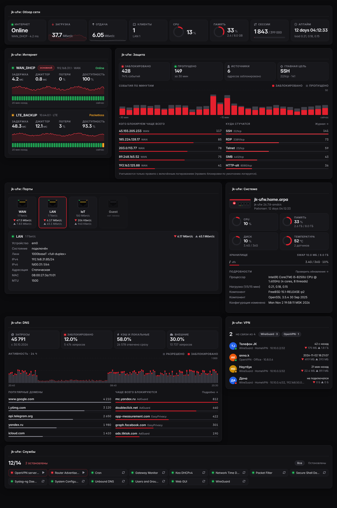

## Возможности

- Файрвол с отслеживанием состояний, NAT, шейпинг трафика, несколько WAN с переключением.
- VPN: WireGuard, OpenVPN, IPsec.
- DNS-резолвер с блок-листами, DHCP, NTP, captive portal, высокая доступность (CARP).
- Дашборд из живых виджетов: обзор сети, интернет и шлюзы, защита, порты, система, трафик,
  устройства, DNS, VPN, службы, а также виджеты функций jk-ufw (угрозы, устройства, страны, гости и другие).
- Веб-интерфейс с API для всех настроек.

| Меню | Панель редактирования | Вход |
|---|---|---|
| 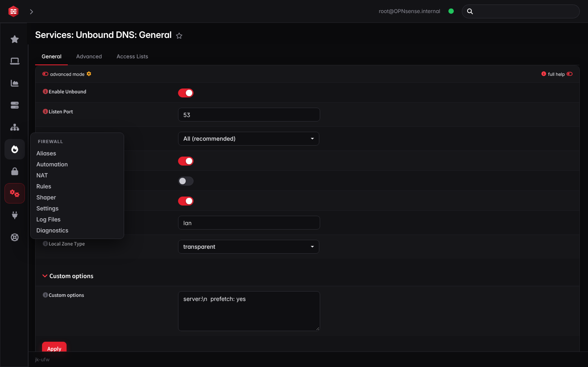 | 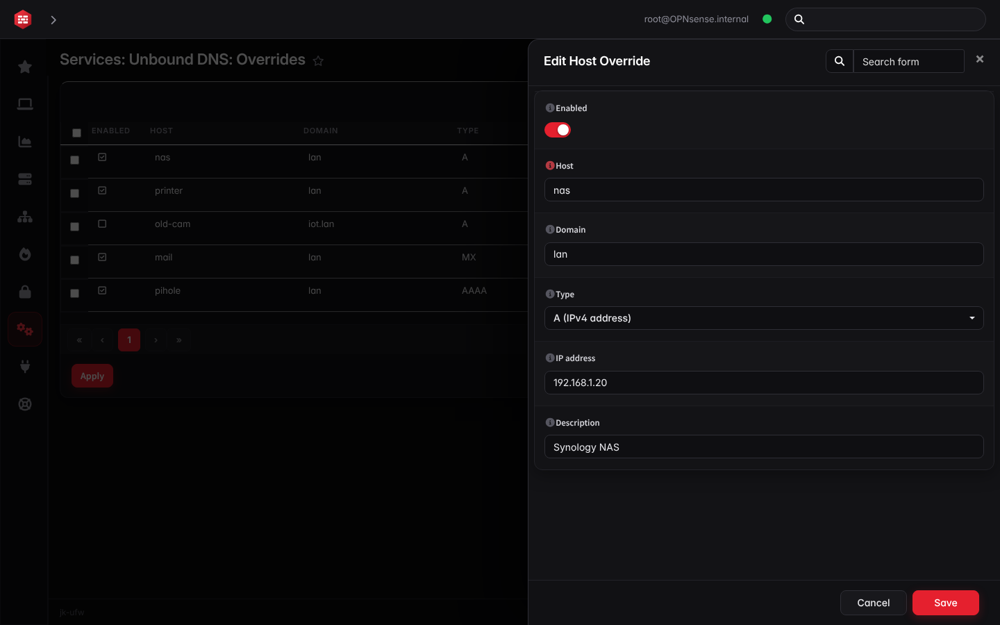 | 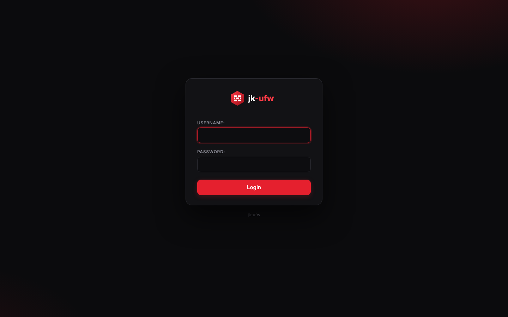 |

## Функции jk-ufw

Восемь собственных страниц поверх стандартных служб системы. Каждая настраивается на одном экране, а под капотом
создаёт обычные правила и настройки, которые видны и в стандартных разделах. Подробности о каждой: разделы 7–14 в
[jk-ufw/fork/FORK.md](jk-ufw/fork/FORK.md).

| Функция | Где в меню | Что делает |
|---|---|---|
| **Защита от угроз (IDS/IPS)** | Services › Intrusion Detection › Threat Management | Обнаружение или блокировка атак (Suricata), уровни защиты и категории угроз, журнал событий, виджет |
| **Устройства в сети** | Lobby › Devices | Все клиенты сети с именем, производителем и скоростью, блокировка и ограничение скорости в один клик |
| **VPN с QR-кодом** | VPN › WireGuard › Remote Access | Удалённый доступ через WireGuard: включается одной кнопкой, телефон подключается по QR-коду |
| **Блокировка стран** | Firewall › Country Blocking | Выбор стран на карте мира, входящие, исходящие или оба направления (GeoIP) |
| **Фильтр контента и родительский контроль** | Firewall › Content Filter | Блокировка рекламы, мошенников, 18+ и других категорий, расписание интернета для детских устройств |
| **Контроль приложений** | Firewall › Application Control | Распознаёт ~60 приложений (Telegram, TikTok, YouTube, игры, торренты, VPN, удалённый доступ, ИИ) по имени сервера в TLS/QUIC, протоколу и сигнатурам (Suricata), блокирует выбранные, показывает, какое устройство чем пользуется. В фильтре контента: проверка HTTPS по имени сайта, блокировка DNS через HTTPS и QUIC |
| **Уведомления в Telegram** | System › Settings › Notifications | Сообщения об угрозах, пропадании интернета и входах в веб-интерфейс ([настройка](jk-ufw/features/notify.md)) |
| **Гостевая сеть** | Services › Captive Portal › Guest Network | Отдельная VLAN для гостей со своей страницей входа, изоляцией и ограничением скорости |
| **Мастер первой настройки** | System › Wizard | Интернет, локальная сеть, пароль и защита за четыре шага |

| Защита от угроз | Устройства | VPN |
|---|---|---|
| 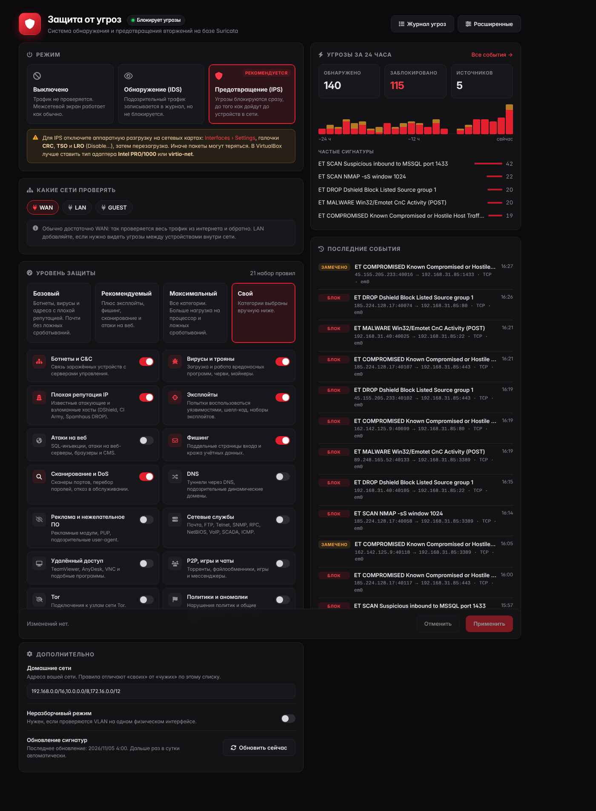 | 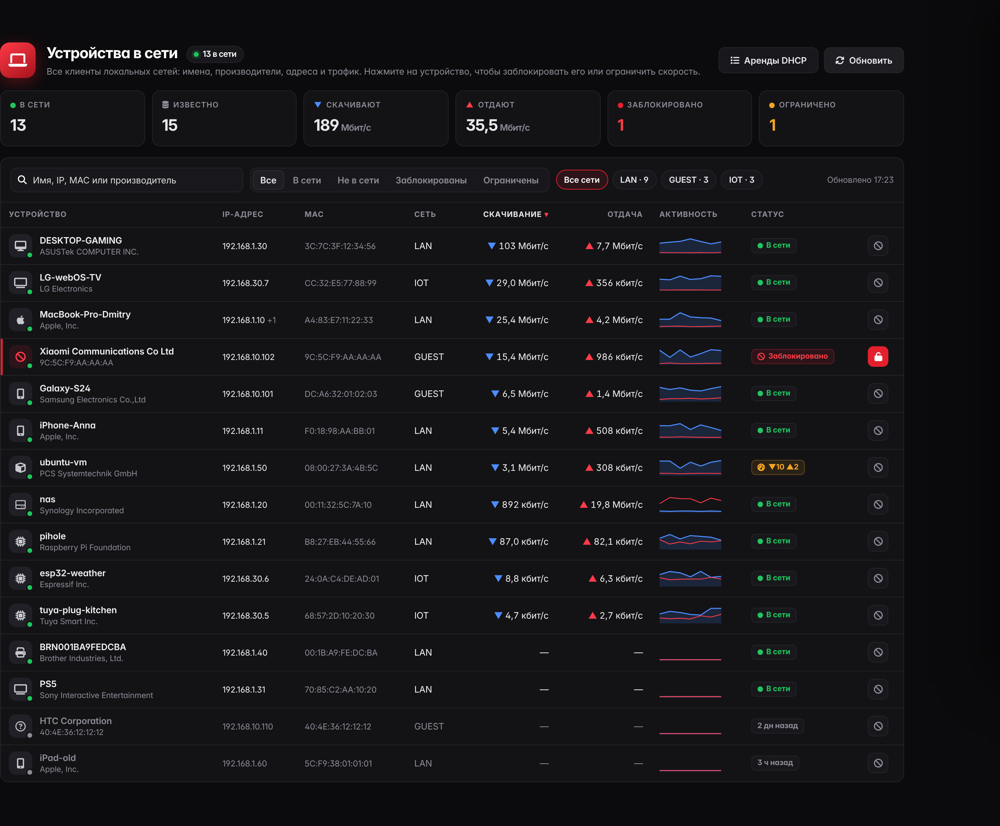 | 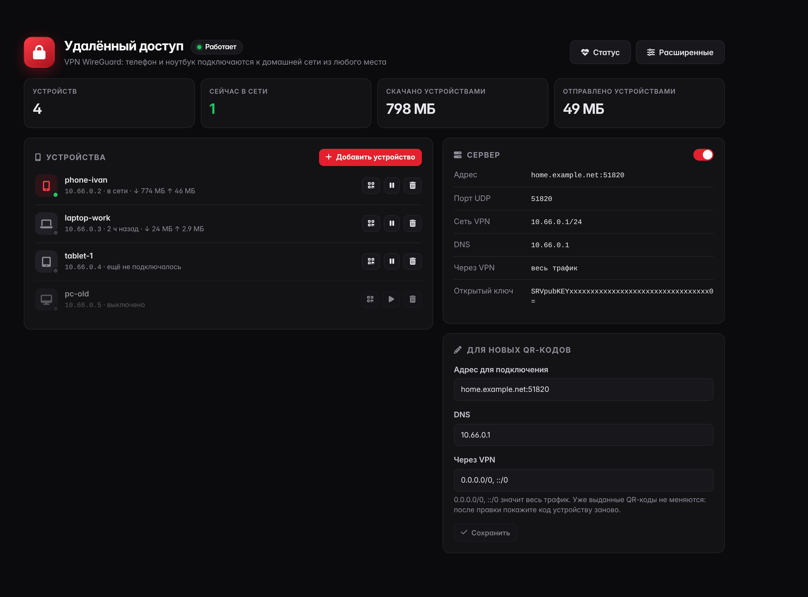 |

| Блокировка стран | Фильтр контента | Уведомления |
|---|---|---|
| 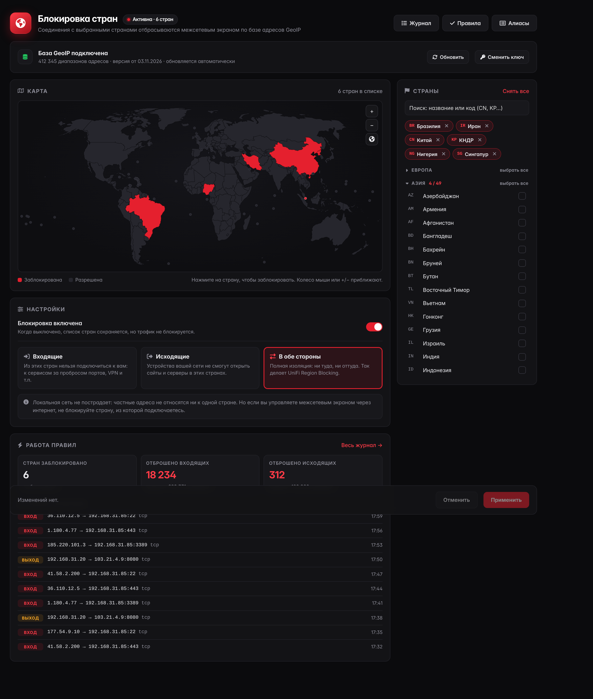 | 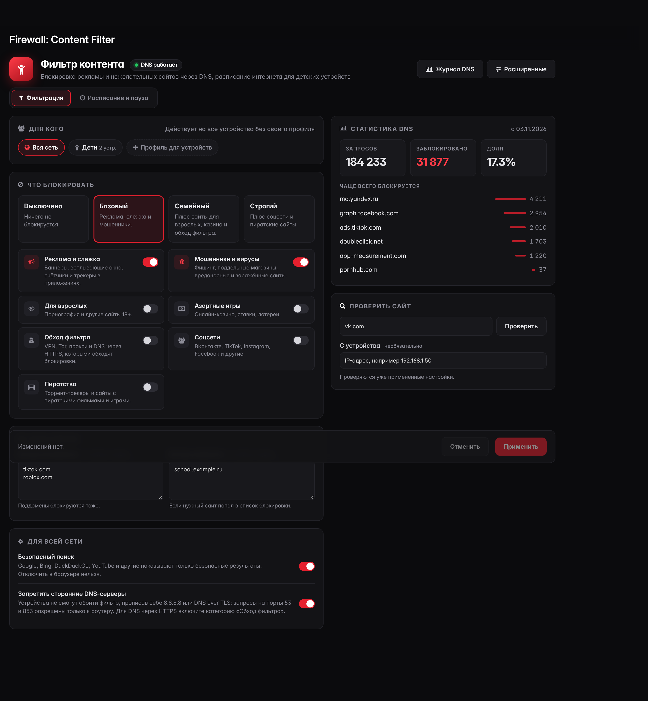 | 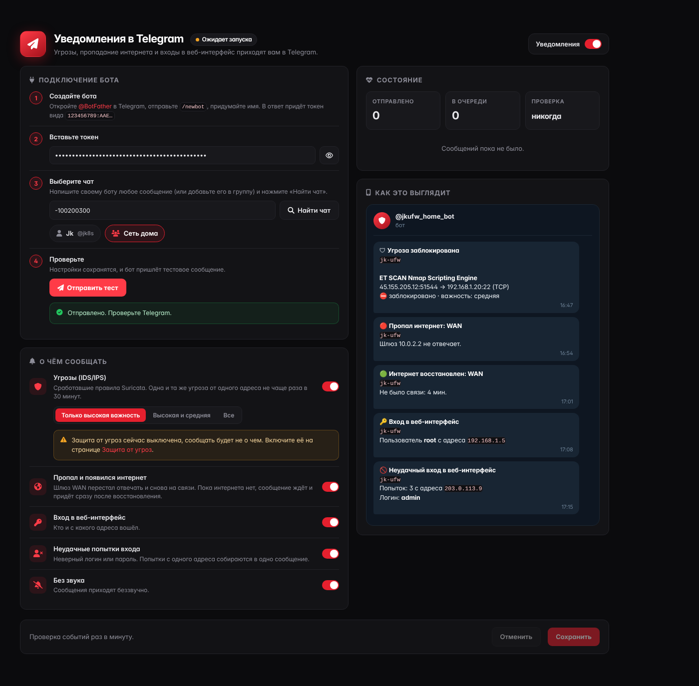 |

| Гостевая сеть | Страница входа для гостей | Мастер настройки |
|---|---|---|
| 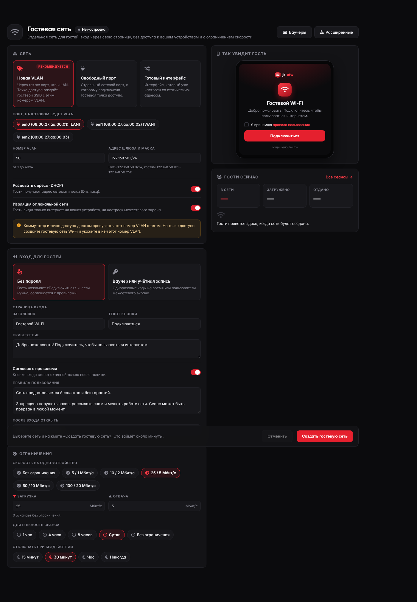 | 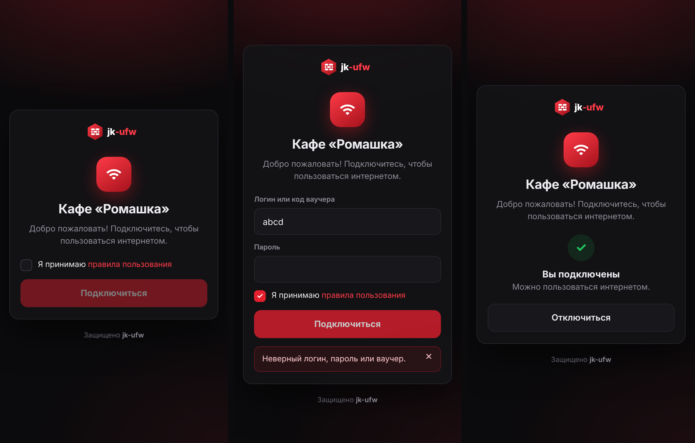 | 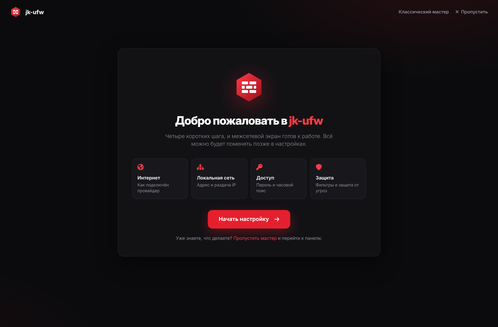 |

| Контроль приложений |
|---|
| 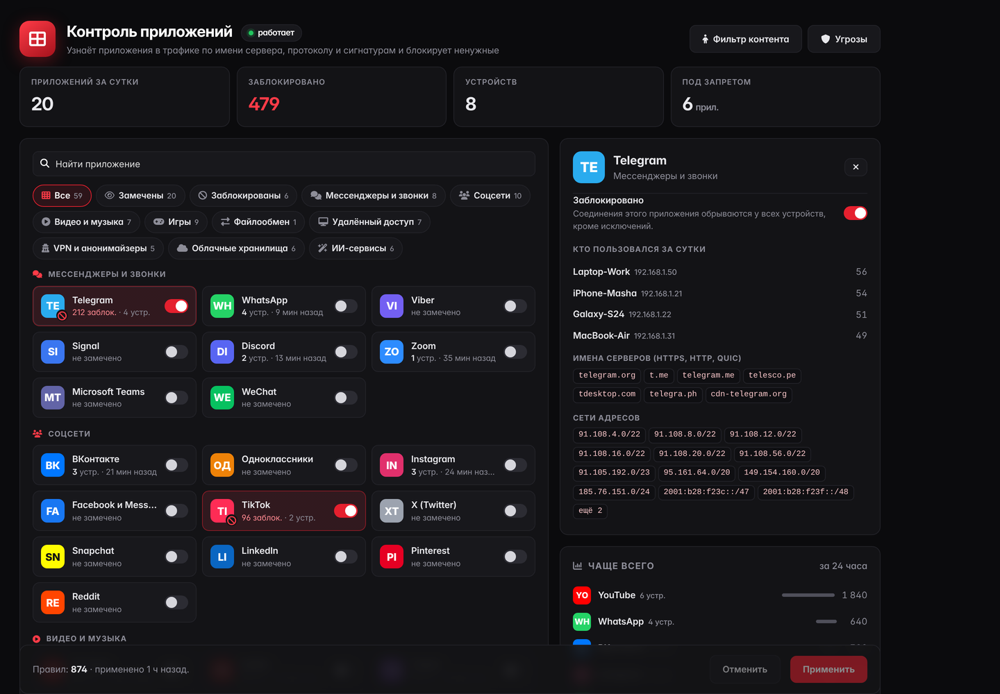 |

## Установка

Готовый установочный образ собирается из этого репозитория, пошагово: [jk-ufw/fork/FORK.md](jk-ufw/fork/FORK.md).
После установки откройте `https://<адрес LAN>` и войдите как `root`, мастер первой настройки откроется сам.

### Добавить функции на уже установленный экран

Если система версии 26.7 уже стоит, все страницы, мастер и виджеты можно поставить без пересборки образа.
Под root (консоль, пункт 8 «Shell», или SSH):

```sh
fetch -o /tmp/try-all.sh https://raw.githubusercontent.com/bfg10kkk/JK-UFW/stable/26.7/jk-ufw/features/try-all.sh
sh /tmp/try-all.sh             # поставить всё
sh /tmp/try-all.sh --remove    # убрать всё
```

Каждую функцию можно поставить и отдельно скриптом `jk-ufw/features/try-<имя>.sh` (ids, devices, vpn, geoblock,
parental, appcontrol, notify, guest, setup). Перед установкой сделайте резервную копию настроек (System › Configuration › Backups).
Обновление системы через System › Firmware перезаписывает эти файлы, после него запустите скрипт ещё раз.

## Структура репозитория

| Путь | Что там |
|---|---|
| `src/` | исходники системы и веб-интерфейса, устанавливаются в `/usr/local` |
| `src/opnsense/www/themes/jkufw/` | тема интерфейса jk-ufw (используется по умолчанию) |
| `src/opnsense/www/js/widgets/JkUfw*.js` | виджеты дашборда |
| `jk-ufw/features/` | скрипты установки функций на работающий экран и инструкции |
| `jk-ufw/` | исходники темы, логотипы, скрипт переименования и инструкция по сборке |
| `Mk/version.mk` | название продукта, сайт, правообладатель |

Внутренние имена каталогов и пакетов (например `/usr/local/opnsense`) оставлены как есть: от них зависят
сборка, обновления и совместимость конфигурации.

## Сборка пакета для разработки

```sh
make package     # собрать пакет из текущего состояния репозитория
make upgrade     # собрать и сразу установить на текущую систему
make lint        # проверки синтаксиса
make style       # проверки стиля PHP и Python
```

## Участие

Сообщения об ошибках и идеи: [Issues](https://github.com/bfg10kkk/JK-UFW/issues). Как оформлять изменения: [CONTRIBUTING.md](CONTRIBUTING.md).
Уязвимости: [SECURITY.md](SECURITY.md).

## Лицензия

jk-ufw распространяется по лицензии BSD 2-Clause. Проект основан на открытом исходном коде,
полный список правообладателей и текст лицензии находятся в файле [LICENSE](LICENSE) и на странице
Lobby › License в веб-интерфейсе. Эти уведомления обязательны по условиям лицензии и не удаляются.
