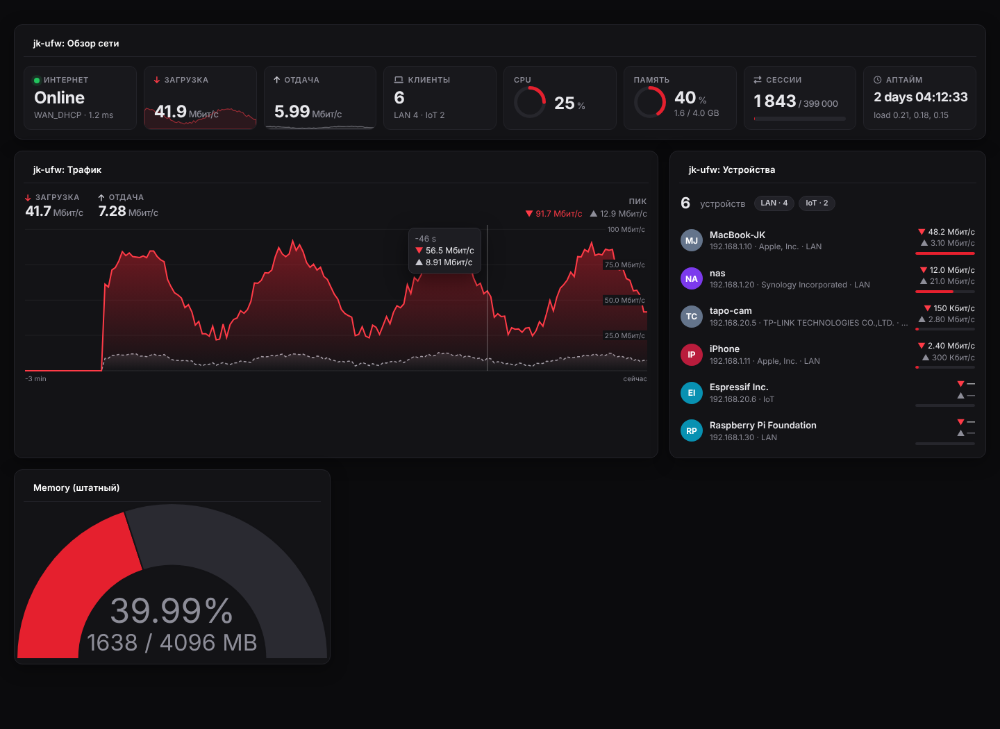
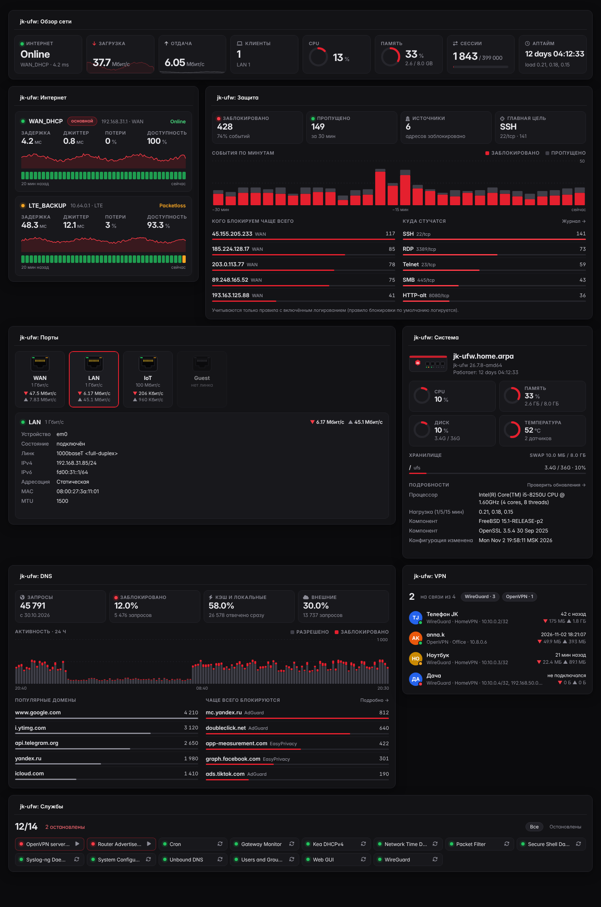
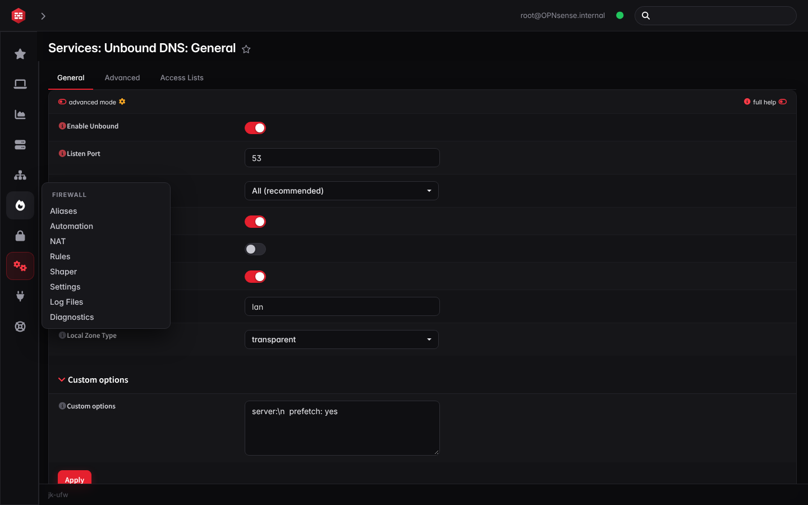
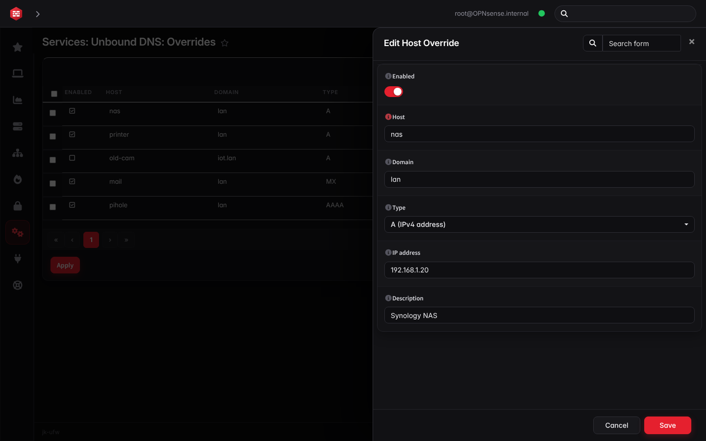
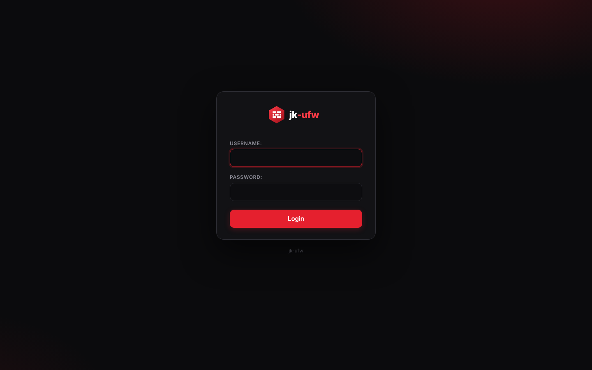

# jk-ufw

Красно-чёрный интерфейс в стиле UniFi для файрвола: меню-полоска с иконками, редактирование в панели справа,
переключатели вместо галочек, новая страница входа, живые виджеты дашборда и собственный логотип jk-ufw.







## Установка на работающий файрвол

1. Включите SSH: System > Settings > Administration > Secure Shell (Enable, Permit root user login, Permit password login).
2. С компьютера скопируйте архив:
   ```sh
   scp jk-ufw-theme.tar.gz root@<IP-файрвола>:/tmp/
   ```
3. На файрволе (ssh, пункт меню 8 — Shell):
   ```sh
   cd /tmp && tar xzf jk-ufw-theme.tar.gz && sh jk-ufw-theme/install.sh
   ```
4. System > Settings > General > Theme → `jkufw` → Save, затем Ctrl+F5.
5. Виджеты: Lobby > Dashboard > карандаш > Add widget > все пункты, начинающиеся с «jk-ufw:», затем Save.

## Виджеты дашборда

| Виджет | Что показывает |
|---|---|
| Обзор сети | Интернет, скорость загрузки и отдачи, клиенты, CPU, память, сессии, аптайм |
| Трафик | График загрузки и отдачи по выбранному интерфейсу |
| Устройства | Подключённые устройства и их трафик |
| Интернет | Каждый шлюз: задержка, джиттер, потери, доступность, история связи за 20 минут |
| Защита | Заблокированные и пропущенные соединения по минутам, кто атакует и на какие порты |
| DNS | Запросы, доля блокировок, кэш, популярные и заблокированные домены |
| Система | Имя, версия, CPU, память, диск, температура, swap, процессор, нагрузка |
| Порты | Интерфейсы в виде панели портов с индикаторами линка и активности, живой трафик, детали по клику |
| Службы | Все службы, остановленные сверху, запуск и перезапуск в один клик |
| VPN | Пиры WireGuard и клиенты OpenVPN: кто на связи, когда был, сколько передал |

Замечания: «Защита» видит только правила с включённым логированием. «DNS» требует включённой статистики
на странице Reporting > Unbound DNS. История «Интернета» копится, пока открыт дашборд, и хранится в браузере.

Удаление: `sh /tmp/jk-ufw-theme/install.sh uninstall`.

Название системы в интерфейсе (заголовки, вход, дашборд, подвал) заменяет `theme.js`: переменные `NAME` и `FOOTER`
в начале файла. Имя хоста в правом верхнем углу — настоящее, его меняют в System > Settings > General > Hostname.

## Форк исходников

Папка `fork/` — скрипт и инструкция, чтобы переименовать сами исходники системы в jk-ufw и собирать свои образы.
Подробно в [fork/FORK.md](fork/FORK.md).

## Устройство пакета

- `src/opnsense/www/themes/jkufw/build/` — готовая тема (пути `src/opnsense/...` повторяют системные каталоги, менять их нельзя).
- `src/opnsense/www/js/widgets/JkUfw*.js` и `Metadata/JkUfw.xml` — виджеты дашборда.
- `overrides/*.css` — слои стиля: `main.css` (цвета), `ui.css` (меню, панели, формы, вход), `grid.css`, `dashboard.css`.
- `assets/` — логотипы, шрифт Inter, `theme.js`.
- `build.sh <клон репозитория plugins>` — пересобирает тему из базового тёмного слоя и слоёв `overrides/`.
- Сменить акцент: `--cr-accent` в `overrides/main.css`, затем `build.sh`.

## Лицензия

BSD-2-Clause, см. `LICENSE`. Часть CSS и шрифтов взята из кода под лицензией BSD-2-Clause; по условиям этой лицензии
исходное уведомление об авторских правах сохранено без изменений в `LICENSE.upstream`. Шрифт Inter — SIL OFL 1.1.
